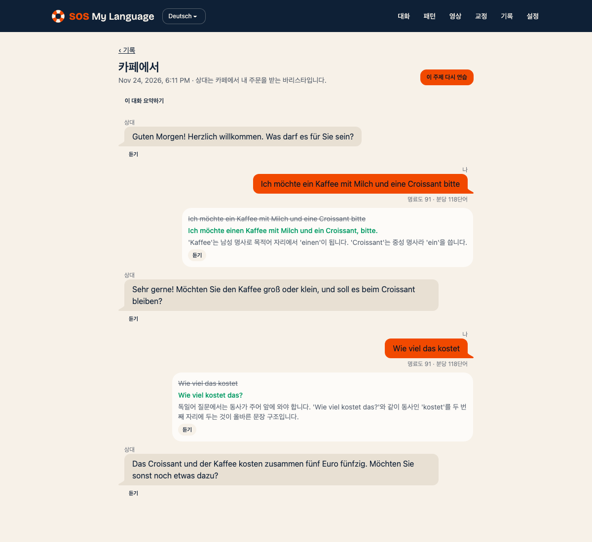
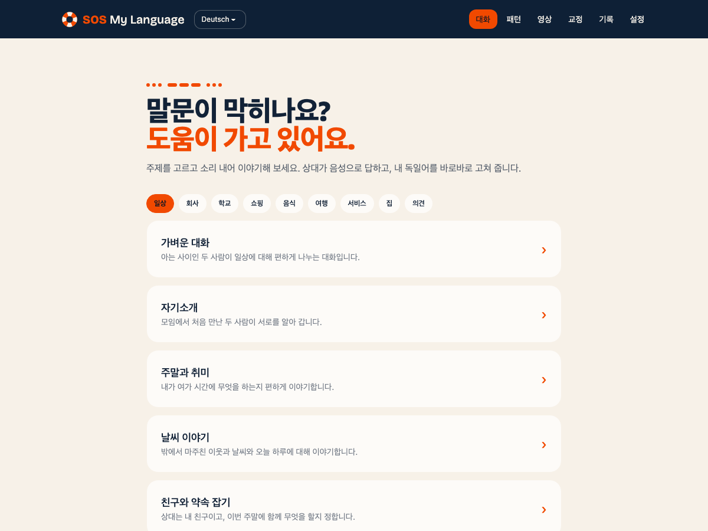

# SOS My Language

[English](README.md) | **한국어**

[](https://github.com/gyedongjeon/sos-my-language/releases/latest)
[](LICENSE)

말문이 막히나요? **배우는 언어로 말하기**를 내 컴퓨터에서 연습하는 앱입니다. 연습할 언어(지금은
**영어**와 **독일어**)를 고르고, 주제를 골라 AI 대화 상대와 소리 내어 이야기하면, 상대가 음성으로
답하고 내가 한 말을 바로바로 고쳐 줍니다.



[SOS My Interview](https://github.com/gyedongjeon/sos-my-interview)와 같은 SOS 시리즈이고,
언어 하나씩을 다루던 [SOS My English](https://github.com/gyedongjeon/sos-my-english)와
[SOS My German](https://github.com/gyedongjeon/sos-my-german)을 하나로 합친 앱입니다.

## 주요 기능
- **여러 언어를 한 앱에서**: 처음 열 때 연습할 언어를 고르고, 화면 위쪽에서 언제든 다른 언어로 바꿀 수 있습니다. 주제, 영상, 패턴, 교정, 기록, 목소리, 음성 인식은 언어마다 따로이고, 한 언어에서 한 것은 다른 언어를 연습하는 동안에도 그대로 남습니다.
- **말하기 중심**: 타이핑이 아니라 목소리로 답합니다. 내가 한 말은 자동으로 받아 적힙니다.
- **듣기부터 연습**: 상대의 말은 음성으로 먼저 들려주고, 글자는 버튼을 눌러야 보입니다.
- **바로바로 교정**: 말할 때마다 가장 중요한 한 가지를 골라, 더 나은 문장과 이유를 보여 줍니다. 말로 하는 연습이라 문장 부호나 대소문자는 고치지 않습니다. 고친 문장은 음성으로 들어 볼 수 있습니다.
- **얼마나 또렷하게 말했는지**: 문장마다 명료도 점수, 잘 인식되지 않은 단어, 말하는 속도를 보여 줍니다.
- **마무리 요약**: 대화를 마칠 때 **마무리**를 누르면 잘한 점, 다음에 연습할 점, 다음에 써 볼 만한 표현을 정리해 줍니다.
- **9개 카테고리, 40개 주제**: 일상, 회사, 학교, 쇼핑, 음식, 여행, 서비스, 집, 의견 말하기로 나뉘어 있습니다.
- **문장 패턴 연습**: A1부터 C2까지 레벨별 패턴 100개. 내 언어로 된 문장을 보고 연습하는 언어로 말하면, 한 판에 다섯 문장씩 맞았는지 확인해 줍니다.
- **유튜브 영상으로 공부**: 링크를 붙여 넣으면 영상을 문장 하나씩 들을 수 있습니다. 반복, 느린 속도, 글자 숨기기, 내 언어 번역 켜고 끄기, 따라 말하기(쉐도잉), 저장한 자막 검색을 지원합니다.
- **내 주제**: 기본 주제 외에 필요한 상황(면접, 렌터카, 고객과의 통화 등)을 직접 추가할 수 있습니다.
- **교정 복습**: 받은 교정은 **교정**에 모입니다. 고친 문장을 듣고, 맞게 나올 때까지 직접 말해 볼 수 있습니다.
- **읽은 글로 주제 만들기**: 기사나 연설문의 링크(또는 글 자체)를 붙여 넣으면 그 내용으로 대화할 주제와 짧은 요약을 만들어 줍니다.
- **대화 기록**: 대화는 하는 동안 자동으로 저장됩니다. **기록**에서 교정과 함께 다시 읽고 들을 수 있습니다.
- **한국어 화면과 설명**: 메뉴, 버튼, 기본 주제와 패턴 설명이 한국어로 나오고, 교정 설명도 한국어로 받습니다. 대화는 연습하는 언어 그대로입니다. (화면은 고를 수 있는 모든 언어로 나옵니다. 영어와 한국어 외의 언어는 AI가 번역했고 원어민 검수를 거치지 않았습니다.)
- **내 컴퓨터에서 실행**: 음성 인식과 상대 목소리는 컴퓨터 안에서 처리되고, 데이터도 내 컴퓨터에만 저장됩니다. 대화 글만 내가 고른 AI 서비스로 전송됩니다. 영상 번역을 켜면 그 영상의 자막 전체가 전송됩니다.

계정 가입이나 서버가 없는 1인용 앱입니다.

## 설치
**Apple Silicon Mac**과 **64비트 Windows**용 설치 파일을 [최신 릴리스](https://github.com/gyedongjeon/sos-my-language/releases/latest)에서 받을 수 있습니다.

### macOS

1. `.dmg` 파일을 내려받아 열고, 앱을 Applications 폴더로 끌어 넣습니다.
2. Apple 개발자 인증서로 서명하지 않은 앱이라 macOS가 처음에는 실행을 막습니다. 터미널에서 아래 명령을 한 번 실행한 뒤 앱을 엽니다.
   ```bash
   xattr -cr "/Applications/SOS My Language.app"
   ```
3. 처음 실행할 때 Python과 Python 패키지(약 450MB)를 내려받습니다. 인터넷 연결이 필요하고 몇 분 걸릴 수 있습니다. 마이크 사용을 물으면 허용해 주세요.

다른 프로그램은 설치하지 않아도 됩니다.

### Windows
1. `SOS-My-Language-Setup-<버전>.exe`를 내려받아 실행합니다. 현재 사용자 계정에만 설치되며 관리자 권한이 필요 없습니다.
2. 서명하지 않은 설치 파일이라 "Windows의 PC 보호" 창이 뜹니다. **추가 정보**를 누른 뒤 **실행**을 누릅니다.
3. 처음 실행할 때 Python 패키지(Python 자체는 설치 파일에 들어 있습니다), 이어서 음성 모델을 내려받습니다. 앱이 목소리를 듣지 못하면 Windows 개인 정보 설정에서 데스크톱 앱의 마이크 사용을 허용해 주세요.

Windows 앱은 macOS 앱보다 훨씬 덜 써 봤습니다. 자동화된 검사 외에는 Windows 11 가상 머신에서 한 번(설치, 첫 실행, 말하기) 확인한 것이 전부입니다. 문제가 있으면 이슈로 알려 주세요.

Intel Mac, Linux용 설치 파일은 아직 없습니다. [소스에서 실행](README.md#run-from-source)할 수 있습니다.

## 업데이트
설치한 앱은 열 때마다 새 버전이 있는지 확인합니다. 새 버전이 있으면 알림 창이 뜨고, "Update and Restart"를 누르면(데스크톱 앱의 알림 창은 아직 영어입니다) 앱이 새 버전을 내려받아 스스로 교체한 뒤 다시 열립니다. 설정은 그대로 유지됩니다. 메뉴의 **SOS My Language → Check for Updates…**로 직접 확인할 수도 있습니다.

- 업데이트 뒤에 macOS가 마이크 권한을 다시 물을 수 있습니다.
- 앱을 Applications 폴더로 옮기지 않고 실행한 경우 등 스스로 교체할 수 없을 때는 다운로드 페이지를 열어 줍니다.
- Windows에서는 새 버전을 알려 주고 다운로드 페이지를 엽니다. 새 설치 파일을 그대로 실행하면 되고, 데이터는 유지됩니다.

## 처음 열 때
앱을 처음 열면 **어떤 언어를 연습할지** 먼저 묻습니다. 고르기 전에는 아무것도 내려받지 않습니다. 언어를 고르면 화면 위에 "음성 모델을 내려받는 중"이 뜨고, 그 언어의 음성 인식 모델(약 480MB)과 상대 음성 모델(영어 약 350MB, 독일어 약 114MB)을 한 번 내려받습니다. 다른 언어의 모델은 그 언어로 처음 바꿀 때 내려받습니다. 진행률이 표시되고, 받는 동안에도 앱을 쓸 수 있습니다. 그동안 상대 목소리는 시스템 기본 음성으로 나오고, 음성 인식 모델을 다 받기 전에 말한 내용은 다운로드가 끝난 뒤 자동으로 이어서 처리됩니다.

## 삭제
앱이 저장하거나 내려받는 것(내 데이터, 음성 모델, 실행에 필요한 파일)은 모두 `~/Library/Application Support/SOS My Language/` 폴더 하나에 있습니다(Windows는 `%APPDATA%\SOS My Language\`). macOS는 앱을 휴지통에 넣어도 이 폴더를 지우지 않으므로, 완전히 삭제하려면 앱과 이 폴더를 함께 지우면 됩니다.

## 처음 설정
연습할 언어를 고르고 나면 **설정** 화면이 나옵니다. 아래 이름은 한국어 화면 기준입니다.

1. **내 언어**: 화면에 쓰이고 교정 설명을 받을 언어를 고릅니다. 시스템 언어가 한국어면 한국어가 미리 선택되어 있습니다.
2. **AI 모델**: 사용할 AI 서비스와 모델을 고르고, 그 서비스의 API 키를 붙여 넣은 뒤 "저장하고 테스트"를 누릅니다.
3. **상대 목소리**(선택): 연습하는 언어의 상대 목소리를 고를 수 있고, 언어마다 따로 기억됩니다. 영어는 미국/영국 억양, 남성/여성 목소리(예: Heart, Michael, Emma, George. 기본은 Heart)가 있고 모두 처음 받은 음성 모델에 들어 있어 추가로 내려받을 것이 없습니다. 독일어는 Thorsten(기본), Kerstin, Ramona 등이 있고, 처음 고를 때 그 목소리를 내려받습니다(21~114MB). "듣기"로 미리 들어 볼 수 있습니다.
4. **연습할 언어**: 연습할 언어를 바꿉니다. 화면 위쪽 앱 이름 옆의 선택 상자로도 바꿀 수 있습니다.

Google Gemini, Claude, OpenAI, OpenRouter 등을 쓸 수 있습니다. API 키는 내 컴퓨터에만 저장되고, 저장한 뒤에는 화면에 다시 표시되지 않으며, 선택한 서비스로만 전송됩니다.

## 사용 방법


1. **대화**에서 카테고리를 누르고 주제를 고르면 상대가 첫마디를 읽어 줍니다. 못 들었다면 "다시 듣기", 글자로 보고 싶다면 "글자 보기"를 누릅니다.
2. "말하기 시작"을 누르고 말한 뒤 "중지"를 누릅니다.
3. 내가 한 말과 교정이 나오고, 상대가 이어서 말합니다. 같은 식으로 대화를 이어 갑니다.
4. "처음부터 다시"로 같은 주제를 처음부터 다시 할 수 있습니다.
5. 대화를 마칠 때 **마무리**를 누르면 요약이 나오고, 대화와 함께 저장됩니다.
6. **교정**에서 교정받은 문장을 골라 "말하기"로 다시 말해 봅니다. 맞게 말하면 횟수가 기록됩니다. 패턴 연습에서 틀린 문장과 영상에서 "따라 말하기"로 따라 말했는데 다 들리지 않은 문장도 여기에 쌓이고(들리지 않은 단어와 대신 들린 말이 함께 나옵니다), 필요 없는 항목은 "빼기"로 지울 수 있습니다.
7. 원하는 주제가 없으면 **대화** 아래쪽의 "+ 내 주제 추가"로 직접 만듭니다. 상황은 한국어로 적어도 되고, 상대의 첫마디는 비워 두면 자동으로 써 줍니다. "링크나 글로 만들기"를 고르면 기사나 연설문의 링크 또는 글을 붙여 넣어 주제를 만들 수 있습니다(영상 링크와 로그인이 필요한 페이지는 읽지 못하니 글을 붙여 넣어 주세요).
8. **패턴**에서 레벨(A1~C2)과 패턴을 고르면, 내 언어로 된 문장이 나옵니다. "영어로 말하기"(독일어를 연습할 때는 "독일어로 말하기")를 누르고 그 언어로 말하면 맞았는지와 더 나은 문장을 알려 줍니다.
9. **영상**에 연습하는 언어의 자막이 있는 유튜브 영상 링크를 붙여 넣으면 자막이 문장 단위로 나뉩니다. 문장을 누르면 그 부분만 재생됩니다. "번역"을 켜면 문장마다 내 언어로 된 번역이 아래에 나옵니다(영상마다 처음 한 번만 AI로 번역하고, 그다음부터는 저장된 번역을 씁니다). "따라 말하기"로 방금 들은 문장을 따라 말하면 어떤 단어가 제대로 들렸는지 보여 주고, 검색 상자로 저장한 모든 영상의 자막에서 표현을 찾을 수 있습니다. "패턴 만들기"로 문장에서 연습하고 싶은 표현의 첫 단어와 끝 단어를 누르면 내 패턴이 만들어져 **패턴**의 "내 것"에서 연습할 수 있습니다. 영상을 추가하면 A1~C2 수준이 자동으로 붙고(영상 화면에서 직접 바꿀 수 있습니다), 목록에서 수준별로 골라 볼 수 있습니다. 영상 화면의 "비슷한 영상 찾기"를 누르면 비슷한 수준의 비슷한 유튜브 영상을 찾아 추천해 주고, "추가"로 바로 추가할 수 있습니다. 영상은 유튜브 플레이어로 재생되며 내려받지 않고, 자막은 이 컴퓨터에 저장됩니다. 유튜브 자동 자막에 문장 부호가 없으면, 영상을 추가할 때 AI가 문장 부호만 붙여 문장 단위로 나눕니다(단어는 바꾸지 않고, 이때 자막 전체가 AI 서비스로 전송됩니다).
10. 지난 대화는 **기록**에서 다시 볼 수 있고, 필요 없는 대화는 거기서 지울 수 있습니다.
11. 다른 언어를 연습하려면 화면 위쪽 앱 이름 옆의 선택 상자에서 언어를 고릅니다. 주제, 영상, 패턴, 교정, 기록이 그 언어 것으로 바뀌고, 이전 언어에서 한 것은 그대로 남아 있습니다.

문제가 생겼을 때 나오는 일부 오류 메시지는 아직 영어로 나옵니다.

## 개발과 기여
소스에서 실행하는 방법, 테스트, 프로젝트 구조는 [영어 README](README.md)를 참고해 주세요.

## 라이선스
[MIT](LICENSE). 독일어 목소리를 읽어 주는 Piper(GPL-3.0)와 그 목소리는 이 저장소나 설치 파일에 들어 있지 않고, 다른 Python 패키지처럼 처음 실행할 때 내려받습니다. 앱에 포함된 글꼴과 라이브러리의 라이선스는 [THIRD_PARTY_NOTICES.txt](frontend/public/THIRD_PARTY_NOTICES.txt)와 앱의 설정 화면에서 볼 수 있습니다.
