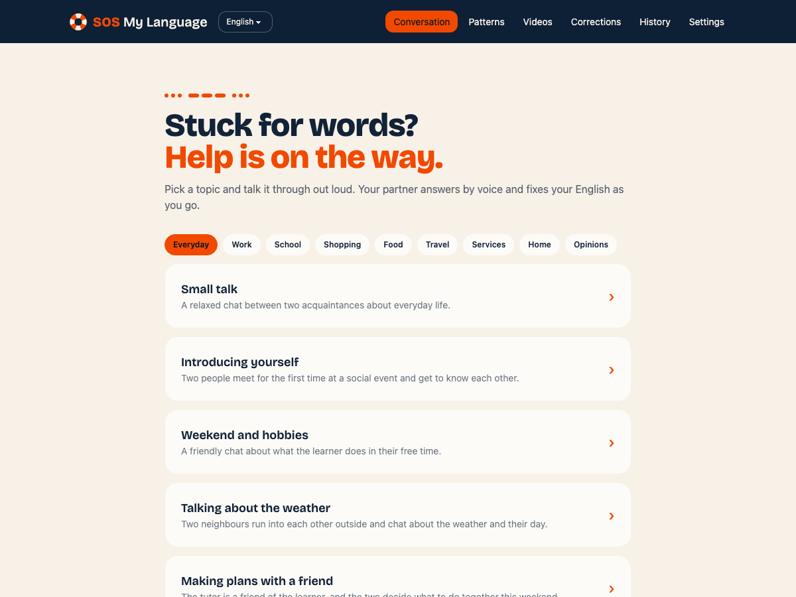

# SOS My English

**English** | [한국어](README.ko.md)

[](https://github.com/gyedongjeon/sos-my-english/releases/latest)
[](https://github.com/gyedongjeon/sos-my-english/actions/workflows/ci.yml)
[](LICENSE)

Stuck for words? An app for practising **spoken English**, running on your own machine. Pick a
topic, talk it through out loud with an AI partner that answers by voice, and get your English
fixed as you go.


Part of the SOS series, next to [SOS My Interview](https://github.com/gyedongjeon/sos-my-interview).

## Features
- **Speaking first**: you answer by voice, not by typing; what you said is transcribed for you.
- **Listening first**: your partner's reply is read aloud, and its text stays hidden until you ask for it.
- **Corrections as you go**: after each thing you say, the most valuable fix is shown with the better sentence and why, and you can hear the better sentence.
- **How clearly you spoke**: each line shows a clarity score, the words that were hard to recognize, and your pace.
- **A summary at the end**: wrap a conversation up to see how it went: what you did well, what to work on next, and a few expressions worth trying next time.
- **40 topics in 9 categories**: everyday chat, work, school, shopping, food, travel, services, home, and giving your opinion.
- **Sentence patterns by level**: 100 patterns from A1 to C2. You see a sentence in your own language and say it in English, five sentences a round, and each one is checked.
- **Study with YouTube videos**: paste a link and listen to the video one sentence at a time, with repeat, slower speeds, the text hidden or shown, and a translation into your language turned on or off. Say a sentence after the speaker to see which words came through, and search all your videos for a phrase to hear how it is used. Mark an expression in a sentence to turn it into a pattern of your own and practise it. Videos are tagged with a level from A1 to C2 and can be listed level by level, and a video can suggest others like it at a similar level.
- **Your own topics**: add the situations you need (a job interview, renting a car, a call with a client) next to the built-in ones.
- **Practise your corrections**: every fix is collected on the Corrections page, where you say the better sentence aloud until it comes out right.
- **History**: every conversation is saved as you have it, with its corrections, so you can read it and hear it again.
- **Explanations in your language**: corrections are explained in Korean, Japanese, Chinese, Spanish, and more; the conversation stays in English.
- **Topics from what you read**: paste a link to an article or a speech, or its text, and get a topic to discuss it, with a short summary to talk from.
- **Private by default**: speech-to-text and your partner's voice run locally, and your data stays on your computer. Only the text of the conversation, and a text or page you make a topic from, goes to the LLM provider you choose, with your own API key. Videos are streamed from YouTube; a part of a video's subtitles is sent to estimate its level and to find videos like it, all of them when they have no punctuation, and a sentence you make a pattern from. Turning on a video's translation sends all its subtitles.

The app runs locally for a single user; there is no account, server, or deployment.

## Install
Installers for **Apple Silicon Macs** and **64-bit Windows** are attached to each
[release](https://github.com/gyedongjeon/sos-my-english/releases/latest).

### macOS

1. Download the `.dmg`, open it, and drag the app to Applications.
2. The build is not signed with an Apple developer certificate, so macOS blocks it at first. Run
   this once in Terminal, then open the app:
   ```bash
   xattr -cr "/Applications/SOS My English.app"
   ```
3. The first launch downloads Python and the Python packages (~450 MB), so it needs an internet
   connection and can take a few minutes. Allow microphone access when asked.
4. The speech models (~830 MB in total) are then downloaded once in the background, with their
   progress shown at the top of the page. You can use the app meanwhile.

Nothing else has to be installed, because the app ships its own [uv](https://docs.astral.sh/uv/).
Use version 0.1.1 or later: 0.1.0 does not start.

### Windows
1. Download `SOS-My-English-Setup-<version>.exe` and run it. It installs for your user account
   only and needs no administrator rights.
2. The installer is not signed, so Windows shows "Windows protected your PC". Choose
   **More info**, then **Run anyway**.
3. The first launch downloads the Python packages (Python itself comes with the installer), and then the speech models, as
   on macOS. Allow microphone access for desktop apps in Windows' privacy settings if the app
   cannot hear you.

The Windows app has been tried far less than the macOS one: once, in a Windows 11 virtual
machine (installing, the first launch, and speaking), beside the automated checks. Please open
an issue if something does not work.

On Intel Macs and Linux there is no installer yet; [run it from source](#run-from-source).

### Where files are kept, and uninstalling
Everything the installed app puts on disk is in one folder,
`~/Library/Application Support/SOS My English/` (on Windows, `%APPDATA%\SOS My English\`):

- `data/` — your conversations, settings, and the speech models
- `venv/`, `uv-cache/`, `python/` — the Python packages and Python itself, set up on the first launch

To back up or move your conversations, copy `data/`. Nothing is written to shared caches such
as `~/.cache`. Deleting the app leaves this folder in
place, so to uninstall completely, move the app to the Trash and then delete that folder.

### Updates
The installed app asks GitHub for the latest release when it starts. When there is a newer one,
it offers to update: one click downloads it, replaces the app, and opens it again, with your
settings kept. You can also choose **SOS My English → Check for Updates…**.

- The download is checked against the SHA-256 that GitHub reports for the release file, and only
  files from this repository's releases are accepted. The app is not signed by Apple, so that
  check, not an Apple signature, is what the update relies on.
- After an update macOS may ask for microphone access again.
- If the app cannot replace itself (for example, it was not moved to Applications), it opens the
  download page instead.
- On Windows the app tells you about a new version and opens the download page; run the new
  installer over the old version. Your data is kept.

## First setup
The app opens on the Settings page the first time.



1. **Feedback language**: pick the language your corrections are explained in. It starts from
   your system language.
2. **AI model and API key**: choose a provider and model and paste that provider's API key. It is
   saved and checked with a test request.

Under Settings you can also choose your partner's voice, American or British, male or female; see
[Text-to-speech](#text-to-speech).

Replies and corrections are written by an LLM through
[LiteLLM](https://docs.litellm.ai/docs/providers), so any supported provider works (Gemini,
Claude, OpenAI, OpenRouter, a local Ollama model, ...). Both settings can be changed any time
under Settings. The key is stored in the local database (`app.db`), is never shown again in the
UI, and is sent only to the chosen provider.

## How it works
### Conversation
Each topic sets a situation (small talk, ordering at a café, a meeting at work, ...) and an
opening line. The home page shows the built-in topics one category at a time; the ones under
Opinions have no role to play and ask you to talk at more length about what you think. After each thing you say, the LLM gets the conversation so far and returns your
partner's next line together with at most one correction of what you just said.

Besides the built-in topics you can add your own on the home page: a title and the situation
(who your partner is and what you talk about, in any language). Your partner's first line can be
typed in or left empty, in which case the LLM writes it. An own topic can be deleted; the
conversations held on it stay in History.

A topic can also be made from something you read: choose "From a link or text" and paste a
link or the text itself, in any language. A link is opened by the app on your computer and the
page's readable text is taken from it ([trafilatura](https://github.com/adbar/trafilatura));
pages that need a login or load their text with JavaScript cannot be read, and links to videos
are refused, so paste the text or the transcript instead. The LLM writes a title, your
partner's first line, and a summary of at most eight sentences in plain English. Only that
summary is kept: your partner knows it during the conversation, and you can open it on the
practice page. The text itself is not stored, and at most 30,000 characters of it are used.

Each line is saved in the local database as it is said, so a conversation is on the History
page even if the app is closed in the middle of it. A conversation can be deleted there.

**Wrap up** ends a conversation with a summary: its numbers (turns, corrections, average clarity
and pace) and a short review written by the LLM from the whole conversation and its corrections,
in your feedback language. It is saved with the conversation, and a conversation that was not
wrapped up can be summarized later from the History page. Saying more after a summary drops it,
so it can be written again for the whole conversation.

### Sentence patterns
The Patterns page lists 100 sentence patterns by CEFR level (A1 to C2), such as "I'd like …",
"should have + past participle", or "Never have I …". There is no official level for a pattern;
each is placed where the grammar it needs is usually taught. Picking one starts a round: the LLM
writes five new sentences that need the pattern, in your feedback language, each with a model
answer in English. You say each sentence in English; the recording is transcribed locally and
the LLM judges it by its meaning, its grammar, and whether the pattern was used, not by whether
it matches the model answer. You can try again, hear the right sentence, or ask for the answer.
A round's score counts the sentences that were right at the first try and is kept with the
pattern; the sentences themselves are not stored. With English as the feedback language, a
short instruction ("Say that you regret …") is shown in place of a sentence to translate.

### Videos
The Videos page takes a link to a YouTube video that has English subtitles. The video is played
by YouTube's own embedded player, inside the app, and is never downloaded. The app reads the
video's subtitles (preferring ones written by a person to automatic ones) and its title, and
saves them in the local database, cut into sentences: a subtitle line breaks where it fits the
screen, so the lines are joined and cut again at the sentence ends, and each sentence gets the
seconds between which it is said. Clicking a sentence plays just that part; it can be repeated,
slowed down, and listened to with the text (and the player's own subtitles) hidden.

**Levels.** When a video is added, the LLM estimates the CEFR level (A1 to C2) a learner needs
to follow it, from sentences taken from its start, middle, and end and from how fast it is
spoken; the whole text is not sent. The Videos page shows the level on each video and lists
one level at a time. On a video's page the level can be changed by hand or estimated again.
Without a configured model a video is saved without a level.

**Shadowing.** "Say it after" stops the video and records you saying the sentence you just
heard. The recording is transcribed locally and compared with the sentence word by word (no
LLM): the page shows the share of words that came through and marks the ones that did not.
Punctuation and capitals are ignored, "I've" equals "I have", and "three" equals "3". Each
sentence keeps its best score. A sentence not said in full goes to the Corrections page, with
the words that were not heard and what was heard in their place ("gaps" heard as "guess"). Every
try, right or not, is also logged with the sentence and what was heard, so the words you are
often not heard saying can be looked into later.

**Translation.** "Translation" on a video's page shows each sentence in your feedback
language under the English. The first time it is turned on for a video, all of the video's
sentences are sent to the LLM, a few dozen at a time, and translated; the translations are kept
in the local database, so the video opens with them afterwards without asking the LLM again.
Sentences a request failed on, or that the LLM left out, are asked for once more right away;
any still without a translation are counted on the page, with "Try again" to ask for just those.
Each feedback language is translated on its own. With English as the feedback language there is
nothing to translate into. A translation follows the sentences as they are cut, so a sentence
cut short by subtitles is translated as it stands.

**Search.** The search box on the Videos page looks for a word or phrase in the subtitles of
all saved videos; a result opens its video at that sentence, so you can hear how the phrase is
used elsewhere.

**Your own patterns.** "Make a pattern" shows the chosen sentence word by word; click the
first and the last word of the expression you want. The LLM turns it into a formula such as
"the closest I've ever gotten to + noun/-ing" with a note on its use, and it is saved under
"Yours" on the Patterns page with the sentence as its example. It is practised like any other
pattern, links back to its place in the video, and stays when the video is deleted. Only the
sentence and the marked part are sent to the LLM.

**Similar videos.** "Find similar videos" on a video's page has the LLM think of two or three
YouTube searches from the video's title and a part of its subtitles. YouTube is searched with
[yt-dlp](https://github.com/yt-dlp/yt-dlp), and the first few videos found (Shorts and videos
over an hour left out) are checked: their English subtitles are read and their level estimated,
as when a video is added. Only those one level apart at most from the video's own are
suggested, nearest first; "Add" saves one and opens it. Nothing is saved until you add it. A
search asks the LLM up to seven times and takes about ten seconds.

- The subtitles are read, and YouTube is searched, the way YouTube's own page does it, not
  through an official interface, so this can stop working when YouTube changes something. A video whose owner does
  not allow embedding cannot be played.
- Subtitles are kept on this computer; deleting a video deletes them, but not its sentences on
  the Corrections page (left without a link to the video) or the log of your tries at saying
  them after it. Besides the parts sent to
  estimate a level, all of them are sent to the LLM when they have no punctuation (below) and when
  their translation is turned on.
- **Automatic subtitles.** YouTube's automatic subtitles sometimes have no punctuation, so they
  cannot be cut at sentence ends. When a video is added with such subtitles, the LLM adds the
  punctuation and the capitals, up to 300 words a request, four requests at a time. Only the
  marks and the capitals are taken from its reply: every word stays as YouTube wrote it, even
  where the LLM "corrected" a recognition error, and keeps its time. A part whose reply is too
  unlike the words (fewer than nine in ten found in it), and the whole video when no model is set
  up, is kept line by line as YouTube shows it. A video added before this was in place keeps its
  lines; delete it and add it again to have it cut into sentences.

### Practising corrections
The Corrections page lists the fixes from all saved conversations, the sentences you got
wrong in pattern practice (with the sentence that was asked for), and the sentences of a video
you did not say in full after it (with the words that were not heard, linked to the sentence). "Say it" records you, the
recording is transcribed locally like any other line, and the words are compared with the better
sentence: punctuation and capitals are ignored, "I'm" equals "I am", and the sentence may be part
of something longer. A match is counted ("Said right ×2"); otherwise the page shows what was heard
and which words were missing. Speech recognition mishears too, so a try can be counted by hand.
No LLM is used for this. A correction can be removed from the list; one from a conversation
stays in that conversation. Deleting a conversation removes its corrections. In pattern
practice, a new wrong try at the same sentence replaces the earlier one, and an answer that was
only shown, not tried, is not kept. In shadowing, likewise, a new try at the same sentence that
is not in full replaces the earlier one.

### Speech-to-text
What you say is transcribed locally with [Whisper](https://github.com/SYSTRAN/faster-whisper): no
API key is needed and the audio never leaves your machine. The `small.en` model (~480 MB) is
downloaded into the data folder (`whisper/`) in the background when the app is first opened, with
its progress shown at the top of the page; a recording made before it is there waits for it. Set
the `WHISPER_MODEL` environment variable to use another one. Because it is spoken, punctuation and capitals are
never corrected. The clarity score is Whisper's confidence in the words it heard, a proxy for how
clearly they were pronounced. Allow microphone access when asked.

### Text-to-speech
Your partner's lines are read aloud with a local
[Kokoro](https://github.com/thewh1teagle/kokoro-onnx) voice. Its model files (~350 MB) are
downloaded in the background when the app is first opened, and rendered clips are cached in
`backend/data/tts/cache/`.

**Choosing the voice.** Under Settings, "Partner's voice" offers Kokoro's most natural English
voices: Heart (the default), Bella, Nicole, and Sarah (American, female), Michael, Fenrir, and
Puck (American, male), Emma and Isabella (British, female), and George and Fable (British, male).
British voices speak with British pronunciation. All of them are in the same model files, so
choosing one downloads nothing more, and "Hear it" plays a sample. Without a choice, the
`TTS_VOICE` environment variable names the voice, which may be any Kokoro voice; a choice made
under Settings comes first. While the download is running, or if the backend cannot produce audio, the browser's built-in voice is
used instead.

## Run from source
You need [uv](https://docs.astral.sh/uv/) and Node.js. Run the backend and frontend in separate
terminals, then open http://localhost:5173.

```bash
# Backend (http://127.0.0.1:8000)
cd backend
uv run uvicorn app.main:app --reload

# Frontend (http://localhost:5173)
cd frontend
npm install
npm run dev
```

To set the model and API key from a file instead of the Settings page (handy with a fresh data
folder, or for trying another provider), copy `backend/.env.example` to `backend/.env`, fill it
in, and start the backend with `uv run --env-file .env uvicorn app.main:app --reload`. `.env` is
git-ignored; a model saved on the Settings page takes priority over it. (LiteLLM also loads
`backend/.env` by itself when the backend is started in `backend/`.)

### Desktop app
The desktop app is an Electron window that starts and stops the backend for you.

```bash
cd desktop
npm install
npm run dev    # run from this checkout, using backend/data
npm run dist   # build desktop/release/SOS My English-<version>-arm64.dmg
```

`npm run dist` first downloads the uv release pinned in `desktop/scripts/fetch-uv.mjs` (checked
against its SHA-256) into `desktop/vendor/`, to bundle it into the app, so the built app needs
nothing else installed. Releases are built and published by GitHub Actions when a version tag is
pushed; see [docs/git-workflow/versioning.md](docs/git-workflow/versioning.md).

The packaged app keeps its files in `~/Library/Application Support/SOS My English/`; see
[Where files are kept, and uninstalling](#where-files-are-kept-and-uninstalling).

## Tests
```bash
cd backend && uv run pytest     # API and logic, against a temporary data folder
cd frontend && npm test         # unit tests (Vitest)
cd desktop && npm test          # unit tests (Vitest)
```

The backend tests never call a real LLM, Whisper, or Kokoro, and never reach the network. The
exception is nine "live" tests that send real requests to a model and check the shape of its
replies; they run only when asked for, with a key in `backend/.env`:

```bash
cd backend && uv run --env-file .env pytest -m live
```

Opening a pull request into `main`, and every later push to it, runs all three suites, the live tests (with a key kept as the
repository secret `GEMINI_API_KEY`; without it they skip themselves), the frontend build, and the
desktop type check (`.github/workflows/ci.yml`).

## Structure
- `backend/` — FastAPI app. Everything it stores lives in `backend/data/` (git-ignored): the SQLite file `app.db` (topics, conversations, settings), the `whisper/` speech-recognition model, and the `tts/` voice model and cache.
- `frontend/` — Vue 3 app; `/api` requests are proxied to the backend by Vite. Once built (`npm run build`), the backend serves it too, so http://127.0.0.1:8000 alone runs the whole app.
- `desktop/` — Electron shell that starts the backend and shows the app in a window.

Built with FastAPI and SQLite (backend), Vue 3, TypeScript, Vite, Pinia, and Tailwind CSS + daisyUI
(frontend), and Electron (desktop).

## License
[MIT](LICENSE). Third-party work shipped in the built app — the libraries and the heading font, Bricolage
Grotesque (SIL Open Font License 1.1) — is credited in
[frontend/public/THIRD_PARTY_NOTICES.txt](frontend/public/THIRD_PARTY_NOTICES.txt), which is also served by the app at
`/THIRD_PARTY_NOTICES.txt`.
